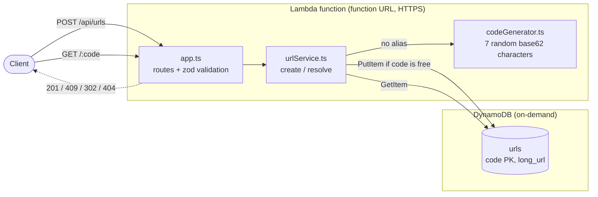

# URL Shortener

Node + TypeScript + Hono, on AWS Lambda and DynamoDB. A short code is 7 random base62 characters, written only if it is free.

## Architecture



- **Deployed:** the function URL is the public address and runs the function. There is no server to keep running, and nothing is paid for while idle. A CDN in front of it is planned ([ADR 0006](docs/decisions/0006-move-to-lambda-and-dynamodb.md)). Locally it's one Node process (`src/server.ts`) and DynamoDB Local.
- **Create:** a custom alias is written as the code. Otherwise `codeGenerator` makes a random code and writes it. The write only succeeds if the code is free: a taken alias returns `409`; a taken generated code is replaced by a new one, up to 5 times.
- **Resolve:** the table is read by its key `code`, and the app answers with a `302` redirect, or `404`. A code that isn't found is read once more, strongly consistent, so a new link never answers `404`.

## Run locally

Needs Node.js at the version in `.node-version`, and Docker for DynamoDB Local.

```bash
docker compose up -d
cp .env.example .env
npm install
npm run db:setup
npm run dev
```

## Deploy

[`infra/`](infra/README.md) runs the app on AWS as a Lambda function with a function URL, and the links in DynamoDB. A push to `main` that changes the app is tested, zipped and deployed by GitHub Actions (`.github/workflows/ci.yml`, then `deploy.yml`). The one-time setup, the manual first run and rollback are in [`infra/README.md`](infra/README.md).

What protects the app and its deployment, and what isn't covered yet: [`docs/security.md`](docs/security.md).

## API

- `POST /api/urls` with `{ "url": "https://...", "alias": "optional-alias" }` returns `201 { code, shortUrl, longUrl }`. `shortUrl` uses the address the request was sent to. `400` on invalid input, `409` if the alias is taken.
- `GET /:code` redirects (302) to the original URL, or `404`.
- `GET /health`

Example:

```bash
curl -X POST "$(terraform -chdir=infra/app output -raw url)/api/urls" \
  -H "Content-Type: application/json" \
  -d '{"url": "https://example.com/some/very/long/path", "alias": "my-link"}'
```

## Test

Tests use a separate DynamoDB Local (`dynamodb-test`, port 8001), in memory so it is wiped on restart, configured in `.env.test`, because they empty the table. Vitest refuses to run if the table name doesn't end in `_test`.

```bash
docker compose up -d
npm run db:setup:test
npm test
```

## Assumptions

This is a design exercise. Design decisions (code length, storage, caching) are sized against the scale below, but the app runs on free or near-free infrastructure, so the deployed version isn't expected to handle that load.

- No private links
- Up to 1 billion stored URLs.
- 100 million daily active users.
- About 1 billion redirects and 10 million new links a day (on average about 11,600 and 115 per second).
- Spikes of up to 100 times that, without warning, for example when a link goes viral.