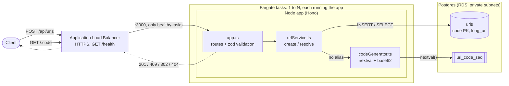

# URL Shortener

Node + TypeScript + Hono + Postgres. Short codes come from a Postgres sequence (`nextval('url_code_seq')`), base62-encoded and offset so codes are at least 6 characters.

## Architecture



- **Deployed:** requests go through an Application Load Balancer to whichever tasks pass the health check. All tasks share one Postgres (RDS). Locally (see Run locally) it is just one app process and one Postgres. Details in [infra/README.md](infra/README.md).
- **Create:** a custom alias is inserted as the code. Otherwise `codeGenerator` takes the next sequence value, base62-encodes it (offset so codes are at least 6 characters) and inserts it. A unique violation on an alias returns `409`; on a generated code (it collided with an alias) the next value is tried, up to 5 times.
- **Resolve:** `urls` is looked up by primary key `code` and the app answers with a `302` redirect, or `404`.

## Run locally

```bash
docker compose up -d
cp .env.example .env
npm install
npm run migrate
npm run dev
```

## Deploy

The `Dockerfile` builds the app image. Terraform in [`infra/`](infra/README.md) runs it on AWS with ECS Express Mode (Fargate behind an Application Load Balancer) and RDS Postgres; see its README for prerequisites, deploying, rollback, teardown and cost.

## API

- `POST /api/urls` with `{ "url": "https://...", "alias": "optional-alias" }` returns `201 { code, shortUrl, longUrl }`. `shortUrl` uses the address the request was sent to. `400` on invalid input, `409` if the alias is taken.
- `GET /:code` redirects (302) to the original URL, or `404`.
- `GET /health`

Example:

```bash
curl -X POST http://localhost:3000/api/urls \
  -H "Content-Type: application/json" \
  -d '{"url": "https://example.com/some/very/long/path", "alias": "my-link"}'
```

```json
{"code":"my-link","shortUrl":"http://localhost:3000/my-link","longUrl":"https://example.com/some/very/long/path"}
```

Leave out `alias` to get a generated code. Then open `http://localhost:3000/my-link` (or `curl -i` it) to be redirected.

## Test

Tests use a separate Postgres (`postgres-test`, port 5433), RAM-only so it is wiped on restart, configured in `.env.test`, because they truncate tables. Vitest refuses to run if the database name doesn't end in `_test`.

```bash
docker compose up -d
npm run migrate:test
npm test
```

## Assumptions

This is a design exercise. Design decisions (code length, storage, caching) are sized against the scale below, but the app runs on free or near-free infrastructure, so the deployed version isn't expected to handle that load.

- No private links
- Up to 1 billion stored URLs.
- 100 million daily active users.